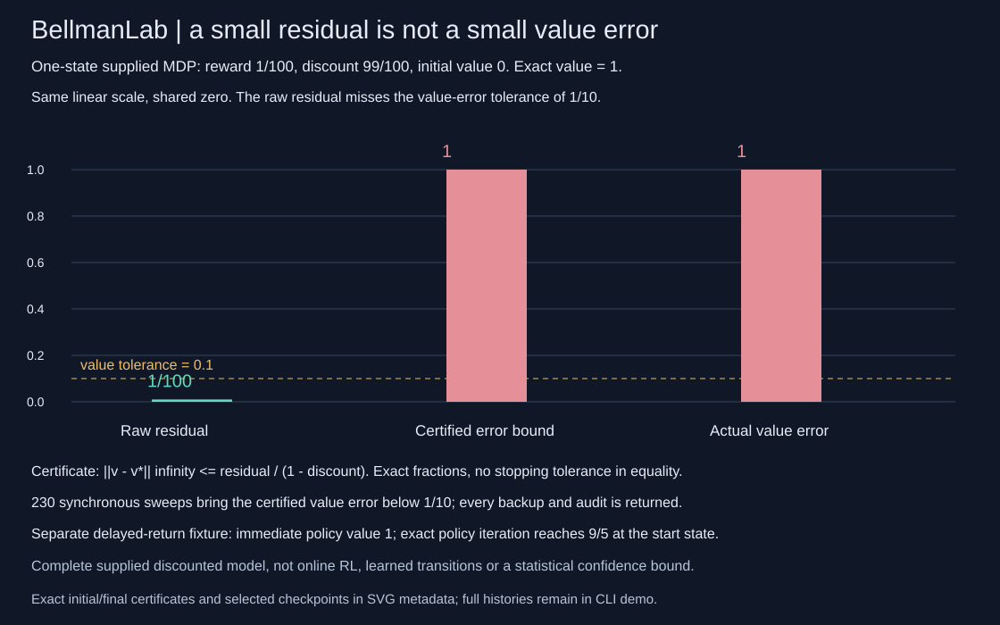
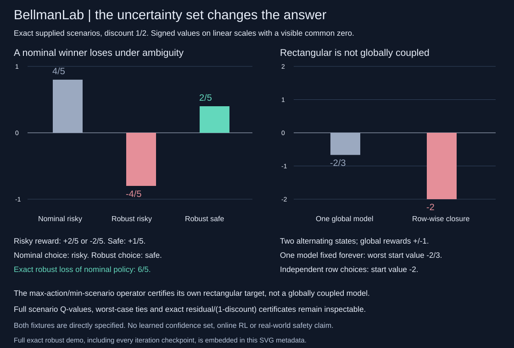
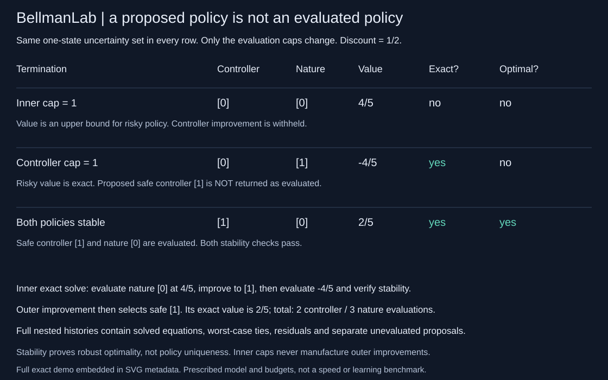

# BellmanLab

Exact rational planning for small supplied discounted Markov decision processes. Dependency-free Python 3.10+, strict JSON CLI, full iteration histories and independently tested certificates. This is model-based planning, not learning an environment from samples.



## A small residual can hide a large value error

```sh
python -m bellmanlab demo
python -m unittest discover -s tests -v
PYTHONPATH=. python examples/render_audit.py --check
```

The directly specified one-state model has reward 1/100, discount 99/100 and a self-transition with probability one. Its exact discounted value is `(1/100)/(1-99/100) = 1`. Starting from value zero:

| Quantity | Exact value | Within value-error tolerance 1/10? |
|---|---:|---|
| Raw Bellman residual | 1/100 | Yes, but this is the wrong quantity to gate |
| Certified value-error upper bound | 1 | No |
| Actual value error, independently known | 1 | No |

For the optimality operator T, the contraction certificate is `||v-v*||_infinity <= ||Tv-v||_infinity/(1-discount)`. A residual is not an interchangeable value-error tolerance. BellmanLab gates the bound. With synchronous backups, 230 sweeps bring that certified error below 1/10; the initial audit and all 230 subsequent audits are returned. The demo asserts the initially passing raw-residual test, failing certified-error test and eventually passing certified-error test. This constructed example is not a convergence-rate benchmark or a statistical confidence interval.

A separate three-state model contrasts immediate reward with delayed return. At state zero, action zero pays 1 then moves to a zero-reward absorbing state. Action one pays 0 then reaches a state paying 1/5 forever. With discount 9/10, the immediate policy has start value 1, while exact policy iteration chooses the delayed action and returns 9/5. Both use the same complete supplied model. The fixture does not measure sample efficiency or generalize to an unknown environment.

## What is implemented

- `audit(model, values)`: exact action values, Bellman backups, all greedy ties, sup residual and certified value-error bound.
- `evaluate_policy(model, policy)`: exact rational solution of `(I-discount*P_policy)v = reward_policy`, full action values and a separate Bellman-optimality audit. Policy-equation residual zero alone does not mean the policy is optimal.
- `value_iteration(model, initial=None, sweeps=100, tolerance=[1,1000])`: synchronous full backups and complete audit history; stops only when the certified value-error bound meets the tolerance or the sweep cap is reached. A cap is not reported as convergence.
- `policy_iteration(model, initial=None, iterations=64)`: exact policy evaluation, strict greedy improvement and complete policy/value/action traces. Old actions are retained on exact ties. A stable policy is optimal; hitting the cap returns the last **evaluated** policy with `optimal=false`, not an unevaluated proposed improvement.

Scores and probabilities are exact fractions of the **explicit input rationals**, not rounded floats. No numerical equality tolerance is used. All ties are returned; the first tied action is the audit's deterministic greedy representative, while policy improvement keeps an already-greedy old action. Neither behavior is a unique-policy claim. Output fractions are `[numerator, denominator]` arrays in lowest terms.

## Input and CLI

A version-1 model has an exact discount in [0,1), and indexed states with one or more actions. An action has one expected immediate reward and a sparse successor-probability row. The reward is state/action based, not a separate transition-dependent reward. A terminal outcome is represented by an ordinary zero-reward absorbing state.

```json
{
  "version": 1,
  "discount": [99, 100],
  "states": [
    {"actions": [
      {"reward": [1, 100], "transitions": [{"next": 0, "prob": 1}]}
    ]}
  ]
}
```

Every input rational is an integer or `[integer numerator, positive integer denominator]`; floats, bools and numeric strings are rejected. Each transition row must sum **exactly** to one. Duplicate successors, invalid indices, unknown keys and duplicate JSON object keys are errors. Zero-probability stored transitions are permitted and counted, not silently removed. State and action order define their indices.

```sh
python -m bellmanlab audit examples/residual.json --values '[0]'
python -m bellmanlab evaluate examples/delayed.json --policy '[0,0,0]'
python -m bellmanlab value examples/residual.json --sweeps 256 --tolerance '[1,10]'
python -m bellmanlab policy examples/delayed.json
python -m pip install .
bellmanlab policy examples/delayed.json
```

Limits: 1..16 states, 1..8 actions per state, at most 64 actions and 512 stored transition entries in total, absolute rewards <=100, integer input numerators and denominators <=1,000,000 in magnitude (denominators positive). The least common multiple of normalized model denominators must be <=1,000,000; initial values must preserve that combined denominator budget. Value iteration allows 0..256 sweeps; policy iteration allows 1..64 evaluations. JSON model files are limited to 256 KiB. These are operational scope limits, not runtime or memory-byte guarantees. Rational arithmetic has variable integer bit cost. Full histories deliberately retain earlier audits.

Value iteration counts model transition-entry reads for every full Bellman audit, including the initial and final audit. Its planned count is an upper bound under the requested sweep cap; the executed count reflects early stopping. These counts exclude validation, Fraction arithmetic/bit cost, comparisons, serialization, policy evaluation and Python-object overhead. They are not FLOPs, wall time or a comparison against an implementation that skips final residual verification.

## Why the checks matter

The original 34 tests include 243 fixed two-state stochastic models, each with all four deterministic policies evaluated by an independent closed-form two-by-two Cramer-rule oracle: 972 exact policy evaluations. Policy iteration matches the per-state optimal envelope over those policies. Every returned value-iteration checkpoint is checked against that independently computed optimum and its certified bound. Other tests reconstruct each synchronous backup, full action values and tie sets; verify closed-form near-one-discount values and a 16-state delayed chain; cover zero discount, negative rewards, exact tiny advantages, retained ties, monotone policy values, cap semantics, final-audit read counts, nonzero linear pivots, strict validation, denominator/action/transition budgets, model/output/RNG isolation, JSON round trips and all CLI commands. Four figure tests inspect every bar and tolerance coordinate, exact selected certificate metadata, byte regeneration and rejection of a changed undisplayed history entry.

The SVG embeds complete exact initial/final certificates, six explicitly selected history checkpoints (0,1,10,100,229,230) and the complete delayed-policy trace. The full 231-audit value history remains in the demo API/CLI. No rational certificate is rounded for a stopping decision. The figure uses one linear scale and a shared zero, not separate scales that make the residual look comparable to the error.

Dynamic programming, policy evaluation/improvement and value iteration follow [Sutton and Barto, Chapter 4 lecture slides](https://people.montefiore.uliege.be/lwh/AIA/Dynamic-programming-Sutton.pdf). Code, rational contracts, fixtures, independent test oracles and figure are original. The residual proof and cap semantics are in [DESIGN.md](DESIGN.md). MIT licensed. No network, API key, paid service, model download, GPU or external dataset is needed.

Only finite, fully observed, discounted, fully specified models are supported. No learned transition/reward model, online interaction, stochastic-policy search, partial observability, undiscounted/average-reward guarantee, statistical confidence or certified greedy-policy-loss claim is made. Exact arithmetic does not validate whether the supplied model represents the world.

## Finite-scenario rectangular robust planning



`robust_audit` and `robust_value_iteration` accept `{"version":1,"scenarios":[model0,model1,...]}`. Each scenario is a complete ordinary model in the schema above. Scenarios must share the discount and the number of states/actions at every state. The set contains 1..8 scenarios and at most 2,048 stored transition entries across all scenarios; the combined normalized model-denominator LCM, including initial values when supplied, is capped at 1,000,000. Each scenario still obeys all ordinary limits. The existing 256 KiB JSON-file and 256-sweep caps apply.

**The scenario index is not one global model choice.** At each state/action nature may independently select any listed scenario's reward/transition row, after observing the action. This deliberately forms the `(state,action)`-rectangular closure of the listed models. Both rewards and transitions can vary. It does not solve an ambiguity set that couples one index across states, actions or time.

```python
from bellmanlab import robust_audit, robust_value_iteration
certificate = robust_audit(problem, values)
planning = robust_value_iteration(problem, sweeps=100, tolerance=[1,1000])
fixed_policy = robust_value_iteration(problem, policy=[0,0], sweeps=100)
```

For each state and action, the audit returns every exact scenario Q-value, the minimum across scenarios and every minimizing scenario index. It then maximizes these minima over actions, retaining every maximizing action. It returns the complete backed-up vector, sup residual and `residual/(1-discount)` value-error certificate. The full initial-plus-each-sweep audit history is kept. Without `policy`, the target is the robust optimal value. With a fixed deterministic `policy`, the backed-up vector selects that policy's worst-case action values: its certificate targets **only that policy's robust value**, even when another action is better. The audit still exposes all action Q-values and greedy ties, but zero fixed-policy residual does not establish optimality. Greedy-action representatives are not policy-loss certificates.

```sh
python -m bellmanlab robust-demo
python -m bellmanlab robust-audit examples/robust.json --values '[0]'
python -m bellmanlab robust-value examples/robust.json --sweeps 32 --tolerance '[1,1000000]'
python -m bellmanlab robust-value examples/robust.json --policy '[0]'
PYTHONPATH=. python examples/render_robust.py --check
```

Two directly specified controls make the modeling choice visible:

| Supplied fixture | Exact result |
|---|---|
| One state, discount 1/2, risky reward +2/5 or -2/5, safe reward +1/5 | The nominal risky value is 4/5. Its robust value is -4/5; the robust safe optimum is 2/5. The nominal policy loses 6/5 in robust value. |
| Two alternating states, discount 1/2, globally opposite reward vectors `[1,-1]` and `[-1,1]` | Keeping one global scenario fixed gives worst start value -2/3. The rectangular closure permits a negative row at both states and has value -2. They are different problems, not two solvers for the same uncertainty set. |

Exact fixed-point audits independently confirm the displayed rational values; the robust demo also returns certified finite-sweep runs. The second SVG uses signed common-zero bars, one linear scale per explicitly separated panel, with the full exact demo and every iteration checkpoint embedded in metadata. No parameter, seed or fixture search selects these examples.

The v0.2 foundation has 54 tests, retaining the 34 original checks and adding 16 robust API/CLI tests plus four robust SVG tests. A new independent oracle enumerates four controller policies and four stationary adversary choices on each of 243 two-state/two-scenario models: 3,888 closed-form two-by-two Cramer evaluations. Per-policy minima and the controller maximum reproduce exact robust fixed points. Every returned checkpoint reconstructs all scenario Q-values, worst-case ties, greedy ties, synchronous vectors, residuals and bounds against the independent oracle. Tests distinguish a fixed-policy target from optimality, match the ordinary solver for singleton uncertainty, cover permutations/duplicates, signed rewards, zero discount, early stops/caps, zero-probability read accounting, aggregate entry and LCM boundaries, invalid schemas and JSON/CLI budgets. The SVG tests check every signed bar, both zero axes, complete exact metadata, regeneration and rejection of a changed undisplayed checkpoint.

Read counts include all stored scenario transition entries in every audit, including fixed-policy mode's all-action tables and the final residual audit. Planned `(sweeps+1)*aggregate_entries` is an upper bound; executed `number_of_audits*aggregate_entries` reflects stopping. These counts do not include rational bit costs, validation, comparisons, serialization or object overhead. They are not timing, FLOP or RAM measurements.

The rectangular robust-DP formulation is attributed to [Iyengar, Robust Dynamic Programming (2005)](https://pubsonline.informs.org/doi/10.1287/moor.1040.0129) and [Nilim and El Ghaoui, Robust Control of Markov Decision Processes with Uncertain Transition Matrices (2005)](https://people.eecs.berkeley.edu/~elghaoui/Pubs/RobMDP_OR2005.pdf). This finite scenario reward-and-transition contract, implementation, exact certificates, fixtures, tests and figures are original. No external code or dataset is copied. These are supplied ambiguity sets, not statistically learned confidence sets. Nothing certifies an unlisted environment or real-world control safety; there is no coupled-uncertainty solver, online RL, stochastic-policy search or greedy-policy-loss bound.

## Exact nested controller and adversary policy iteration



`robust_evaluate_policy(problem, policy, initial_nature=None, iterations=64)` solves the supplied controller's worst-case value by exact adversary policy iteration. Each nature policy selects one scenario row per state for the controller's action. The solver uses the existing rational Gauss-Jordan evaluator, checks every linear equation, audits all scenario values, and changes nature only for a strict minimizing improvement. It retains the current scenario on every exact tie. A stable nature policy has zero fixed-controller robust residual and gives the exact robust value.

`robust_policy_iteration(problem, initial=None, iterations=64, nature_iterations=64)` nests that evaluation inside controller improvement. **The controller is never improved from an unfinished inner solve.** Once nature stabilizes, the controller keeps its action if it is among the robust greedy ties; otherwise it selects the first maximizing action. Exact nature values decrease during the inner solve; exact controller robust values increase during outer improvement. Every evaluated controller/nature policy, solved value, all-scenario Q/tie audit, separate proposed policy and stability flag remains in the nested history. The return includes the number of controller evaluations and total nature evaluations; it does not label those as FLOPs or time.

```sh
python -m bellmanlab robust-policy-demo
python -m bellmanlab robust-evaluate examples/robust.json --policy '[0]'
python -m bellmanlab robust-evaluate examples/robust.json --policy '[0]' --iterations 1
python -m bellmanlab robust-policy examples/robust.json
python -m bellmanlab robust-policy examples/robust.json --iterations 1
python -m bellmanlab robust-policy examples/robust.json --nature-iterations 1
PYTHONPATH=. python examples/render_robust_policy.py --check
```

The same prescribed one-state model exposes both independent caps:

| Run | Returned evaluated controller / nature | Returned value | Exact controller robust value? | Robust optimal? |
|---|---|---:|---|---|
| Inner nature cap 1 | `[0]` / `[0]` | 4/5 | No. This is an upper bound; the true risky robust value is -4/5. | No. Controller improvement is withheld. |
| Outer controller cap 1, completed inner solve | `[0]` / `[1]` | -4/5 | Yes | No. Proposed safe action `[1]` is stored separately, not passed off as evaluated. |
| Both policies stable | `[1]` / `[0]` | 2/5 | Yes | Yes. No uniqueness claim. Two controller evaluations and three nature evaluations. |

`exact=false` in fixed-policy evaluation means the returned value belongs to the last **evaluated stationary nature policy**. It is a componentwise upper bound on that controller's robust value, not an exact worst case. The returned fixed-policy residual certificate still bounds distance to the robust policy value. Outer output separately labels `policy_value_exact`, `optimal` and the termination reason. If nature hits its cap, `improved_policy` is null and outer improvement stops. If only the controller cap is hit, the last exact evaluated controller value is returned, with the proposed controller kept only in history. Both budgets require integers in 1..64; at most 4,096 exact nature evaluations can occur in one outer call. This is an operational limit, not a guarantee that the budgets suffice on every supported model or a bound on integer bit cost/RAM.

70 total tests add 12 exact nested-policy tests and four third-SVG tests to the retained 54 checks. On the same 243-model exhaustive grid, another independent enumeration of 3,888 controller/adversary Cramer solutions verifies every exact fixed-controller value, each returned nature witness, the final controller/nature pair, inner value decrease, outer value increase, minimizing/greedy tie sets, residual bounds and evaluation counters. Additional tests cover both cap failures, withheld outer improvement, retained controller/nature ties, negative rewards, tiny exact advantages, a 16-state chain, invalid policies/budgets, output isolation and CLI modes. Third-SVG tests check all 15 displayed result cells, full exact nested metadata, regeneration and changed-undisplayed-certificate rejection. The eight-module v0.3 wheel reproduces the policy demo outside the source tree. Both prior SVGs remain byte-reproducible.

This is exact supplied rectangular-model planning when stability is reached, not a new learning algorithm, statistical confidence set, coupled-uncertainty solver, unique-policy guarantee or real-world safety claim. Exact rational linear solves alone establish the value of their evaluated policy pair; the separate inner and outer stability checks establish the stronger robust-policy and optimality claims.

## The policy between the policies: one expected-cost budget

[Interactive exact occupancy inspector](https://midya8.github.io/bellmanlab/) · [Contract, derivation and inspected source ledger](OCCUPANCY.md)

An equal initial mixture of “wait forever” and “exit now” policies is **not** a half-exit stationary policy. The two policies visit the decision state at different rates. In the default model their equal mixture has state0mass3/4 and exit occupancy1/4, so the equivalent local exit probability is1/3. Directly averaging the local rows gives cost1/3 and violates the normalized budget1/4. A separate one-state control gives a randomized optimum strictly better than every feasible deterministic policy; a tied correct Lagrange multiplier still needs a feasible primal mixture.

The separate occupancy API enumerates every deterministic policy, constructs the exact attainable cost/reward projection, clips its budget, and returns a two-policy occupancy witness, normalized local action probabilities, every flow row, a re-solved stationary occupancy and a matching dual upper bound. Every action's Bellman inequality and complementarity product is visible. A truly impossible budget gets an attainable minimum-cost lower certificate, not a fake plan. Unreachable states, zero discount, signed costs, slack budgets, whole tied faces, coincident projections and point/line geometry have explicit controls.

The fourth workflow adds18Python tests to the retained70. Native Gauss-Jordan/monotone-chain generation and a separate Cramer/supporting-line checker agree with the browser's exact BigInt reports on861complete inputs. An extra direct full-flow-LP vertex oracle checks28controls/seededmodels. Actual optional SciPy1.15.3/HiGHS solves the full constrained and minimum-cost LPs1,722times across861cases, with explicit numerical tolerance, not an exact arithmetic claim for HiGHS. Four Node/actual-Chrome tests include every policy/feasible vertex, displayed flow/slack rows at1280/390/320 and12trusted completed JSON downloads. Fresh installed-wheel checks preserve all three earlier demo families and both existing entrypoints.

```sh
python -m bellmanlab.occupancy_cli demo --control visitation_reweighting
python -m bellmanlab.occupancy_cli run input.json > certificate.json
python -m bellmanlab.occupancy_cli verify certificate.json
bellmanlab-occupancy demo --control randomization_gap
```

This is a supplied discounted finite model with **one normalized expected-cost constraint**, not a hard trajectory guarantee, new learning method or scalable optimizer. Limits are four states/eight actions; the hull is a two-dimensional return projection, not the full occupancy polytope. All optimal polygon vertices are returned, not all tied policies. Zero-visit first-action fallbacks are arbitrary and labeled. A separate direct LP oracle does operate on full occupancy vertices. All original ordinary/rectangular robust APIs, CLI, three figures and original test sources stay unchanged; this does not combine robust uncertainty with the new constraint. See the exact scaling, independent-check limitations, numerical tolerances and seven-source ledger in [OCCUPANCY.md](OCCUPANCY.md).
